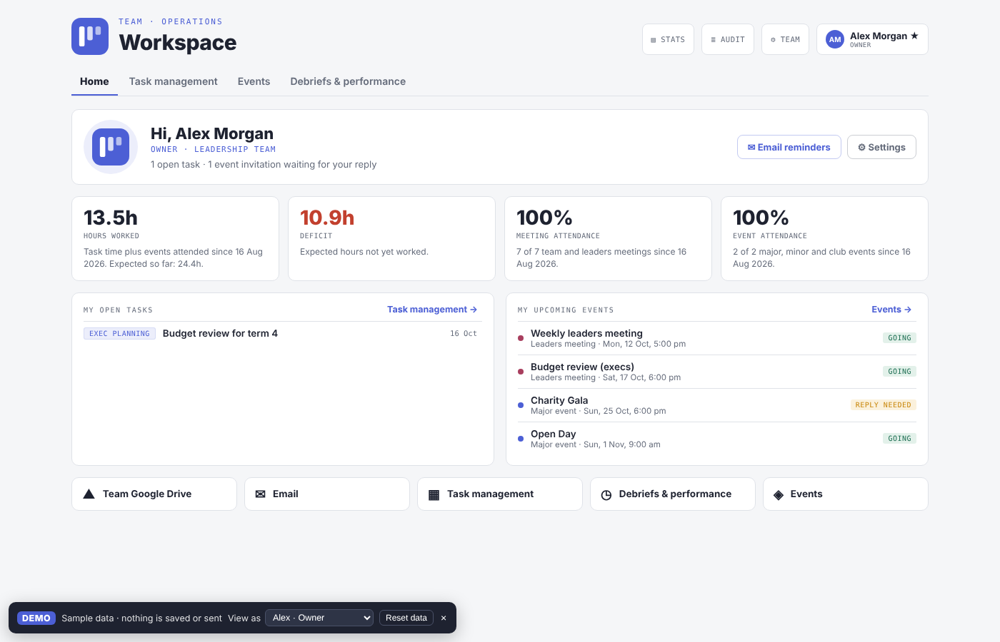
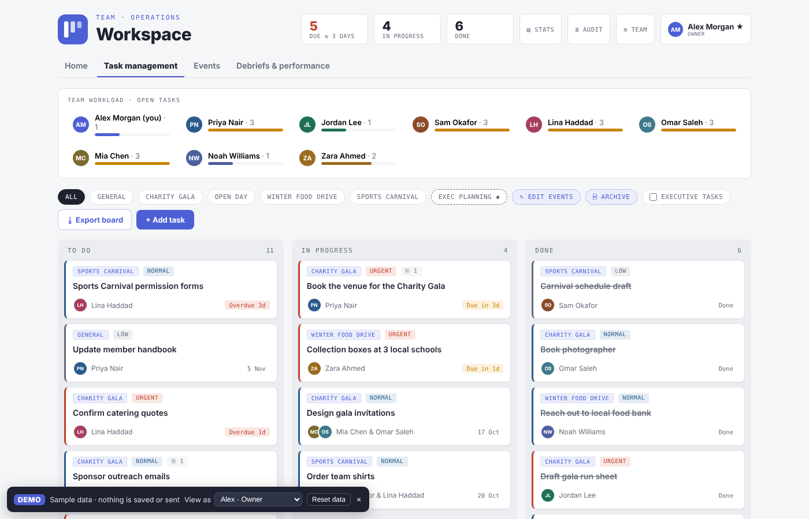
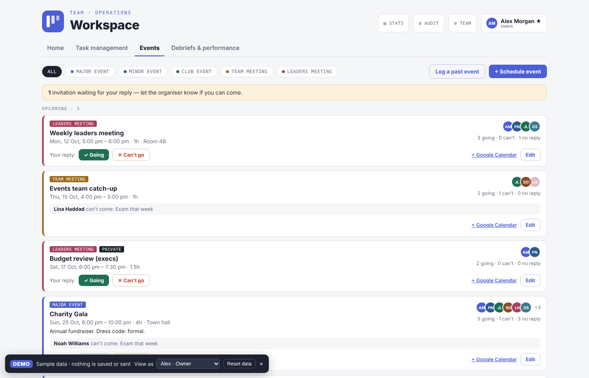
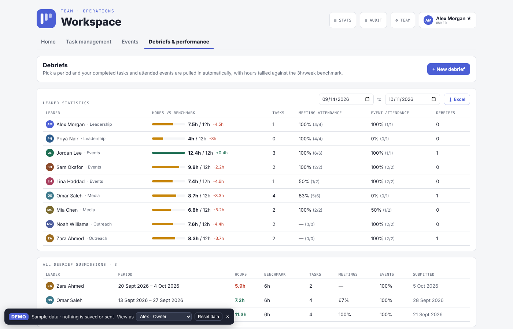
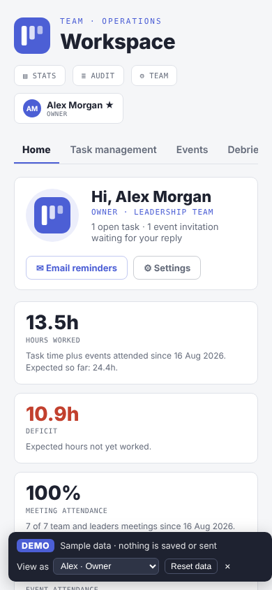

# Workspace

**An operations workspace built for the Sule Amity Graduates Organisation.** It covers task management, events and attendance, volunteer hours and leader performance. The organisation's leadership team uses it day to day to run their work.

**Live demo: [workspace-application-ten.vercel.app](https://workspace-application-ten.vercel.app)** · runs entirely on fictional sample data, no sign-up needed



> The repo is a portfolio copy of the production app. It's the same code, including the newest features. The only difference is that, without database keys, the app starts in **demo mode**: an in-browser mock of the Supabase client serves made-up people and tasks, and nothing is saved or sent. Use the **View as** switcher in the demo bar to see how the app changes for an Owner, an Exec, a Team admin and a Leader.

---

## What it does

| Area | Highlights |
|---|---|
| **Home** | Personal dashboard with hours worked against a weekly benchmark, deficit tracking, meeting and event attendance, open tasks and pending invitations |
| **Task management** | Real-time kanban board with drag and drop, multiple assignees, priorities, due-date warnings and recurring tasks. Also has multi-select filters that update the header stats, Excel export, file links, archiving and executive-only tasks |
| **Events** | Schedule or log five kinds of events and meetings. Each kind has its own permission rules. Invitees can RSVP (with a reason if declining), organisers record attendance, and there's an add-to-Google-Calendar link and private exec events |
| **Debriefs & performance** | Leaders submit period debriefs. Completed tasks and attended events are pulled in automatically and hours are tallied against the benchmark. Execs get a leader statistics table with Excel export |
| **Admin** | Owner-managed members, logins, roles and password resets, plus optional TOTP two-factor auth. Also completion stats with Excel and HTML reports, an audit log, and email reminders sent through Brevo |

<table>
<tr>
<td></td>
<td></td>
</tr>
<tr>
<td></td>
<td align="center"></td>
</tr>
</table>

## Tech stack

- **Frontend:** React 18 + Vite, with hand-rolled inline styling around a shared design-token object (no component library). ExcelJS is lazy-loaded for exports.
- **Backend:** Supabase. That means Postgres with Row Level Security on every table, plus Auth (email/password with TOTP MFA), Realtime and Deno Edge Functions.
- **Email:** Brevo's transactional API, called from an Edge Function.
- **Hosting:** Vercel.

## Engineering notes

- **Security is enforced in the database, not just the UI.** Four roles (Owner, Exec, Team admin, Leader) are resolved by `security definer` SQL helpers (`is_board_admin()`, `can_view_member()`, `can_create_event_kind()`…) that every RLS policy uses. Executive tasks, private events and other people's debriefs are invisible at the API level. Role changes take effect instantly with no redeploy.
- **Triggers keep the data honest.** When a task is moved to Done, a trigger snapshots it into `task_completions`, along with on-time status, days late and minutes worked. Reopening the task flags the snapshot. Recurring tasks spawn their next occurrence from a trigger. All audit-log writes are trigger-only, so clients cannot forge or skip them.
- **Safeguards on account management.** Owner peer-protection rules and a "never remove the last owner" trigger are enforced in three places: SQL, the `manage-users` Edge Function (which holds the service-role key and re-checks the caller) and the UI.
- **Live collaboration.** The board, member list and events update in every open browser through Supabase Realtime. Edits are applied optimistically and roll back if the server rejects them.
- **Incremental, backward-compatible migrations.** The 14 migrations in [`backend/migrations`](backend/migrations) are additive, so the live site keeps working between running the SQL and deploying the code that uses it.
- **A demo mode that exercises the real code.** [`src/demo/mockSupabase.js`](src/demo/mockSupabase.js) implements the parts of the supabase-js API the app uses: the query builder, auth, realtime channels and functions. It also mirrors the server-side policies and triggers. That lets the full app run as a static site with every screen working.

## Project structure

```
src/
  App.jsx              app shell, auth, board, admin panels
  HomePage.jsx         personal dashboard
  EventsPage.jsx       scheduling, RSVPs, attendance
  DebriefsPage.jsx     debriefs + leader statistics
  shared.jsx           design tokens, helpers, performance maths
  supabase.js          real client, or the demo mock when no keys are set
  demo/                mock client, sample data, demo bar
backend/
  migrations/          Postgres schema, RLS policies, triggers (run in order)
  functions/           Supabase Edge Functions (manage-users, send-reminders)
```

## Run it locally

```bash
npm install
npm run dev        # starts in demo mode with sample data
```

To run against a real Supabase project, copy `.env.example` to `.env` and fill in `VITE_SUPABASE_URL` and `VITE_SUPABASE_ANON_KEY`. Then run the files in `backend/migrations` in date order in the Supabase SQL Editor.

## Deploy the demo

Import this repo into Vercel as a new project. It detects Vite automatically, and no environment variables are needed for the demo.

## How it helped the organisation

The Sule Amity Graduates Organisation is run by volunteer leaders, so their time is limited. Before this app, its work was coordinated across group chats and spreadsheets. The app brought that into one place:

- **One source of truth for tasks.** Every task has an owner, an assigner, a due date and a priority, and it sits on a board everyone sees update live. Nobody has to ask in the chat who is doing what.
- **Problems surface early.** Overdue and due-soon tasks are flagged on the board. Reminder emails nudge people about deadlines and unanswered invitations, which leaves less to chase by hand.
- **Volunteer hours are tracked automatically.** Time logged when a task is completed, plus time spent at events attended, adds up to each person's hours against a weekly benchmark. This replaces manual tallies.
- **Attendance is recorded, not remembered.** Meetings and events have RSVPs, reasons for not attending, and attendance records that feed straight into each person's stats.
- **Debriefs take minutes instead of an evening.** A leader picks a date range, and their completed tasks and attended events are already filled in. All that's left is the reflection.
- **Reports are ready for exec meetings.** One-click Excel and HTML exports cover the board, completion stats and leader statistics, so nobody builds reports by hand.
- **Accountability and trust.** Role-based permissions keep exec-only work private, and an audit log records every important change.

## Credits

Built by **Haris Syed** ([@harissyed2006](https://github.com/harissyed2006)) and co-developed with **Mahmoud** ([@Ciny737](https://github.com/Ciny737)). Developed with AI-assisted tooling. All names, emails and data in the demo are fictional.
